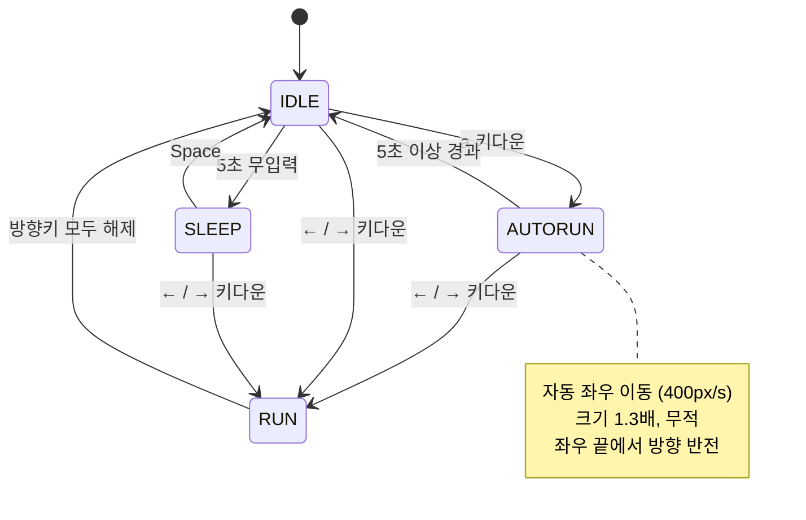

# PRD — Drill #11. 소년: 자동 무적 런(AutoRun) 상태 추가

| 항목 | 내용 |
| --- | --- |
| 문서 버전 | 1.0 |
| 작성일 | 2026-10-27 |
| 대상 | `Drill11` (pico2d 2D 횡스크롤 소년 애니메이션) |
| 과제 | Drill #11 — AutoRun 상태 추가 (5점) |
| 산출물 | `PRD.md`, `AutoRunState` 상태 클래스, 상태 다이어그램 이미지(`docs/state_diagram.png`), 커밋 기록 |

---

## 1. 개요

기존 `Drill11`은 잔디 위의 소년을 `IDLE` / `SLEEP` / `RUN` 세 가지 상태로 제어한다.
이번 과제는 여기에 **자동 무적 런(AutoRun)** 상태를 추가하는 것이다.

`IDLE` 상태에서 `a` 키를 누르면 소년이 **자동 무적 런** 상태로 진입한다. 이 상태에서 소년은
키 입력 없이도 좌우로 계속 이동하고, 이동 속도가 빨라지며, 크기가 확대된다. 화면 좌우 끝에
도달하면 자동으로 방향을 바꾸고, 5초가 지나면 `IDLE`로 돌아간다. 자동 무적 런 중 방향키를
누르면 즉시 자동 런이 취소되고 사용자가 조작하는 `RUN` 상태로 전환된다.

> **핵심 제약:** `AutoRun`은 반드시 **전용 상태 클래스(`AutoRunState`)** 로 구현한다.
> 단순히 `if state == 'AUTORUN'` 분기를 늘리는 방식은 인정하지 않는다.

---

## 2. 현재 상태 (As-Is)

- `main.py`: 60FPS에 가까운 루프, `dt` 상한 0.1초, 이벤트를 `boy`에 위임.
- `boy.py`: `transitions.Machine` 기반 상태 머신.
  - 상태: `IDLE`, `SLEEP`, `RUN` (문자열)
  - 전이: `IDLE→SLEEP`(5초 무입력), `SLEEP→IDLE`(Space), `IDLE/SLEEP→RUN`(방향키), `RUN→IDLE`(방향키 해제)
  - 이동: `RUN_SPEED = 250px/s`, 화면 좌우 `SCREEN_MARGIN = 50px`로 클램프(반전 없음)
  - 그리기: `animation_sheet.png` 100×100 프레임을 `clip_draw`로 1배 크기 출력
- `grass.py`: 배경 잔디만 그리는 정적 오브젝트.

기존 기능(수면, 방향 전환, 애니메이션)은 이번 과제에서 **회귀 없이 유지**되어야 한다.

---

## 3. 목표 (To-Be)

1. `IDLE`에서 `a`를 누르면 `AUTORUN`으로 진입한다.
2. `AUTORUN`은 입력 없이 자동으로 좌우 이동하며, 속도가 빨라지고 크기가 커진다.
3. 화면 좌우 끝에서 자동으로 진행 방향이 반전된다.
4. `AUTORUN` 진입 후 5초가 지나면 `IDLE`로 복귀한다.
5. `AUTORUN` 중 방향키를 누르면 자동 런이 취소되고, 눌린 방향의 `RUN`으로 전환된다.
6. `AutoRun` 전용 상태 클래스를 추가하고, 상태 다이어그램 이미지를 저장소에 포함한다.

### 비목표 (Out of Scope)

- 적, 충돌, 데미지, 체력 등 전투 시스템 (무적은 상태 플래그로만 표현)
- AutoRun 잔여 시간 HUD, 사운드, 이펙트
- 조이스틱/터치 입력, 세이브/로드
- `IDLE`/`SLEEP`/`RUN` 상태 클래스까지 전면 리팩터링하는 작업(단, `AutoRunState`가
  들어갈 수 있는 최소한의 상태 객체 구조는 도입한다 — 6장 참고)

---

## 4. 기능 요구사항

### FR-1. `a` 키로 AutoRun 진입

- `IDLE` 상태에서 `a`(SDL `SDLK_a`) 키다운 시 `AUTORUN`으로 전이한다.
- `SLEEP`/`RUN`/`AUTORUN` 상태에서의 `a` 입력은 무시한다(재진입·타이머 리셋 금지).
- 진입 시 현재 바라보는 방향(`face_dir`)을 그대로 유지하며, 애니메이션과 5초 타이머를 초기화한다.

### FR-2. 자동 이동

- `AUTORUN`에서는 방향키 입력이 없어도 `face_dir` 방향으로 매 프레임 이동한다.
- 이동 속도는 기존 `RUN_SPEED`(250px/s)보다 빨라야 한다. **`AUTORUN_SPEED = 400px/s`** 로 한다.
- 프레임이 밀려도(`dt` 상한 0.1초) 위치가 튀지 않도록 기존 `dt` 처리 방식을 그대로 사용한다.

### FR-3. 크기 확대

- `AUTORUN`에서는 소년을 **1.3배(`AUTORUN_SCALE = 1.3`)** 로 그린다.
- 확대 시 발 위치가 잔디에서 뜨지 않도록, 화면 좌표를 `y + 50 × (scale − 1)`만큼 보정해
  **하단(발) 기준**으로 확대한다.
- 애니메이션은 기존 `RUN` 시트(오른쪽/왼쪽 행)를 재사용한다.

### FR-4. 좌우 끝 자동 방향 전환

- `x`가 화면 좌/우 경계에 닿으면 `face_dir`을 반전한다.
- 경계는 확대된 표시 크기를 고려해 **`AUTORUN_MARGIN = 50 × 1.3 = 65px`**로 클램프한다.
  (`SCREEN_MARGIN` 50px보다 크므로 확대된 스프라이트가 화면 밖으로 잘리지 않는다.)
- 한 프레임 안에서 경계를 넘어가도 화면 밖으로 나가지 않아야 하며, 반전은 1회만 적용한다.
- 반전 후 다음 프레임부터 반대 방향으로 이동하고, 좌/우 애니메이션 행도 함께 바뀐다.

### FR-5. 5초 후 Idle 복귀

- `AUTORUN` 진입 시점부터 경과 시간을 누적한다.
- **`AUTORUN_DURATION = 5.0초`** 이상이면 `IDLE`로 전이한다.
- 복귀 시 위치는 유지하고, `IDLE` 타이머(수면 5초)는 0부터 다시 시작한다.
- 5초 판정과 방향 전환은 같은 프레임에서 충돌하지 않도록, **경과 시간 판정을 먼저** 수행한다.

### FR-6. 방향키로 AutoRun 취소 → Run

- `AUTORUN` 중 `←`/`→` 키다운 시 즉시 `RUN`으로 전이한다.
- `face_dir`은 **눌린 방향**으로 설정한다(자동 진행 방향과 무관).
- 전환된 `RUN`에서는 기존 규칙(방향키를 모두 떼면 `IDLE`)이 그대로 적용된다.
- AutoRun 타이머는 폐기하며, 이후 `IDLE`로 돌아가도 재개되지 않는다.

### FR-7. 무적 표현

- `AUTORUN` 동안 `is_invincible` 속성이 `True`가 된다.
- 현재 데미지/충돌 시스템이 없으므로 시각적·시스템적 효과는 없으며, 이후 확장을 위한
  상태 플래그로만 제공한다. (`IDLE`/`SLEEP`/`RUN`에서는 `False`)

### FR-8. 기존 기능 유지

- `IDLE` 5초 무입력 → `SLEEP`, `SLEEP`에서 `Space` → `IDLE`
- 방향키 입력 → `RUN`, 방향키 해제 → `IDLE`
- 8프레임 애니메이션, 수면 자세 회전, 잔디 배경은 변경 없이 동작한다.

---

## 5. 상태 정의 및 전이

### 5.1 상태 목록

| 상태 | 설명 | 무적 | 표시 크기 | 이동 |
| --- | --- | --- | --- | --- |
| `IDLE` | 가만히 서 있음. 5초 무입력 시 `SLEEP` | ✗ | 1.0× | 없음 |
| `SLEEP` | 누워서 수면. `Space`로 기상 | ✗ | 1.0× | 없음 |
| `RUN` | 방향키로 조작하는 달리기 | ✗ | 1.0× | 250px/s, 입력 방향 |
| `AUTORUN` | **자동 무적 런** | ✓ | **1.3×** | **400px/s**, 자동 + 벽 반전 |

### 5.2 전이표

| # | From | Trigger | To | 부가 동작 |
| --- | --- | --- | --- | --- |
| T1 | `IDLE` | `a` 키다운 | `AUTORUN` | 타이머·애니메이션 초기화, 무적 ON |
| T2 | `AUTORUN` | 경과 ≥ 5.0초 | `IDLE` | 위치 유지, IDLE 타이머 재시작 |
| T3 | `AUTORUN` | `←` / `→` 키다운 | `RUN` | 눌린 방향으로 `face_dir` 설정 |
| T4 | `IDLE` | 5초 무입력 | `SLEEP` | 기존 동작 |
| T5 | `SLEEP` | `Space` 키다운 | `IDLE` | 기존 동작 |
| T6 | `IDLE` / `SLEEP` | `←` / `→` 키다운 | `RUN` | 기존 동작 |
| T7 | `RUN` | 방향키 모두 해제 | `IDLE` | 기존 동작 |

> `AUTORUN`에서 `a` 재입력, `Space`, 키업 이벤트는 상태를 바꾸지 않는다.
> `SLEEP`에서 `a`를 눌러도 `AUTORUN`으로 가지 않는다(T1은 `IDLE` 전용).

### 5.3 상태 다이어그램

제출용 이미지: **`docs/state_diagram.png`** (저장소에 포함, 아래 Mermaid 원본과 동일 내용)
생성 스크립트: `docs/make_state_diagram.py` (Pillow, `python docs/make_state_diagram.py`)



ASCII 개요:

```
[IDLE]
  │ a 키다운
  ▼
[AUTORUN] ──5초 이상 경과──▶ [IDLE]
  │
  │ ←/→ 키다운
  ▼
[RUN] ──방향키 모두 해제──▶ [IDLE]

[IDLE] ──5초 무입력──▶ [SLEEP] ──Space──▶ [IDLE]
[IDLE / SLEEP] ──←/→ 키다운──▶ [RUN]
```

---

## 6. 설계

### 6.1 상태 클래스 구조

`AutoRun` 전용 클래스가 다른 상태 로직과 섞이지 않도록, `states.py`에 상태 객체 구조를 둔다.

```
states.py
├── BoyState            # 공통 인터페이스 (name, enter, update, handle_keydown, handle_keyup, draw)
├── IdleState
├── SleepState
├── RunState
└── AutoRunState        # ★ 이번 과제에서 추가하는 핵심 클래스
```

- `Boy`는 `self.state_obj` 하나를 활성 상태로 보관하고, 이벤트·갱신·그리기를 위임한다.
- 상태 전환은 `Boy.change_state(NewStateClass)`로 일원화한다.
- `AutoRunState`가 소유하는 데이터:
  - `elapsed` (진입 후 경과 시간)
  - `face_dir` (자동 진행 방향)
  - `speed`, `scale` (상수)
- `AutoRunState.update()`가 자동 이동, 벽 반전, 5초 만료 판정을 모두 책임진다.
  `Boy`에는 AutoRun 고유 분기를 두지 않는다.
- 기존 `transitions` 의존성은 제거하고, 전이 규칙을 상태 클래스의 이벤트 처리로 옮긴다.
  (전이표 5.2가 단일 진실 공급원이 되도록 주석으로 대응 관계를 표시한다.)

> **대안 검토:** 기존 `transitions.Machine`을 유지하고 `AutoRunState`만 보조 객체로 두는 방법도
> 가능하지만, "AutoRun 상태 클래스" 요구의 취지(상태별 책임 분리)에 맞지 않고 상태별 분기가
> 다시 `boy.py`로 새어 나오므로 채택하지 않는다.

### 6.2 주요 상수

| 상수 | 값 | 위치 |
| --- | --- | --- |
| `RUN_SPEED` | 250 px/s | `states.py` `RunState` |
| `AUTORUN_SPEED` | 400 px/s | `states.py` `AutoRunState` |
| `AUTORUN_SCALE` | 1.3 | `states.py` `AutoRunState` |
| `AUTORUN_DURATION` | 5.0 s | `states.py` `AutoRunState` |
| `AUTORUN_MARGIN` | 65 px (50 × `AUTORUN_SCALE`) | `AutoRunState.update()` 계산값 |
| `SCREEN_MARGIN` | 50 px | `boy.py` 또는 공통 상수 |
| `FRAME_TIME` | 0.1 s | 공통 애니메이션 설정 |

### 6.3 파일 변경

| 파일 | 변경 |
| --- | --- |
| `states.py` | **신규.** `BoyState` + 4개 상태 클래스 (`AutoRunState` 포함) |
| `boy.py` | 상태 머신 위임 구조로 정리, AutoRun 전용 분기 제거 |
| `main.py` | 변경 없음(이벤트/업데이트 위임 유지) |
| `test_states.py` | **신규.** 수용 기준 자동 테스트(pico2d 스텁 사용) |
| `docs/state_diagram.png` | **신규.** 상태 다이어그램 이미지 |
| `docs/make_state_diagram.py` | **신규.** 다이어그램 생성 스크립트 |
| `PRD.md` | **신규.** 본 문서 |

### 6.4 입력 처리 흐름

```
main.handle_events()
  └─ boy.handle_event(event)
       ├─ KEYDOWN  → state_obj.handle_keydown(boy, key)
       └─ KEYUP    → state_obj.handle_keyup(boy, key)

IdleState.handle_keydown:
  ←/→  → boy.face_dir = ±1; boy.change_state(RunState)
  a    → boy.change_state(AutoRunState)
  기타 → idle_time = 0

AutoRunState.handle_keydown:
  ←/→  → boy.face_dir = ±1; boy.change_state(RunState)   # 자동 런 취소
  a    → 무시
```

### 6.5 그리기 규칙

- `AutoRunState.draw()`는 `RUN` 애니메이션 행을 사용하되 `AUTORUN_SCALE` 배율로 출력한다.
- 확대 기준점은 발밑: `draw_y = boy.y + 50 × (scale − 1)`, `draw_size = 100 × scale`.
- `SleepState`는 기존처럼 90° 회전 + `SLEEP_Y_OFFSET`을 유지한다.

---

## 7. 수용 기준 (채점 기준 매핑)

| 채점 항목 | 점수 | 수용 기준 | 검증 |
| --- | --- | --- | --- |
| `a` 입력 시 AutoRun 진입 | 1 | `IDLE`에서 `a` → 상태 `AUTORUN`, 자동 이동 시작 | T1 |
| 5초 경과 시 Idle 복귀 | 1 | 진입 5.0초 후 상태 `IDLE`, `idle_time == 0` | T2 |
| 속도 증가 + 크기 확대 | 1 | `AUTORUN` 이동 400px/s, 표시 1.3배, `RUN`은 250px/s·1.0배 유지 | T3 |
| 좌우 끝 자동 방향 전환 | 1 | 경계 도달 시 `face_dir` 반전, 화면 밖 이탈 없음 | T4 |
| 상태 다이어그램 | 1 | `docs/state_diagram.png`가 저장소에 포함되고 전이표와 일치 | D1 |
| (공통) PRD/커밋 | - | `PRD.md` 포함, 단계별 커밋 기록 존재 | D2 |

### 테스트 시나리오

| ID | 절차 | 기대 결과 |
| --- | --- | --- |
| T1 | `IDLE`에서 `a` 키다운 | `AUTORUN` 진입, 입력 없이 이동, 무적 플래그 ON |
| T2 | `AUTORUN` 진입 후 5초 대기 | 5.0초 시점에 `IDLE` 복귀, 이후 5초 뒤 `SLEEP` |
| T3 | `AUTORUN`과 `RUN`의 이동량/표시 크기 비교 | 400px/s vs 250px/s, 1.3배 vs 1.0배 |
| T4 | 오른쪽 끝까지 이동 후 계속 관찰 | 경계에서 `face_dir` 반전, `x`가 `[65, W−65]` 유지 |
| T5 | `AUTORUN` 중 `←` 키다운 | 즉시 `RUN`, `face_dir == -1`, 타이머 폐기 |
| T6 | `AUTORUN` 중 `→` 키다운 | 즉시 `RUN`, `face_dir == 1` |
| T7 | `AUTORUN` 중 `a` 재입력 | 상태·타이머 변화 없음 |
| T8 | `SLEEP`에서 `a` 키다운 | 변화 없음(기상은 `Space`만) |
| T9 | 4.9초에 `←` 키다운 | `RUN` 전환, 5초가 지나도 `IDLE`로 자동 복귀하지 않음 |
| T10 | 기존 기능 회귀 | `IDLE→SLEEP`(5초), `Space` 기상, `RUN` 진입/해제 정상 |
| T11 | 창을 드래그해 프레임이 밀린 뒤 복귀 | 캐릭터가 화면 밖으로 튀지 않음(`dt` 상한 유지) |

자동 테스트: `python test_states.py` (T1~T10 로직을 창 없이 검증, 10개 테스트)

---

## 8. 구현 계획 및 커밋 전략

과제 요구사항인 "충분하고 적절한 커밋 기록"을 위해 기능 단위로 나누어 커밋한다.

1. `docs: Drill #11 PRD 추가`
   - 본 문서, 요구사항/전이표/수용 기준
2. `refactor: 소년 상태를 상태 클래스 구조로 분리`
   - `states.py` 도입, `IdleState`/`SleepState`/`RunState` 이관, 기존 동작 유지
3. `feat: AutoRunState 추가 및 'a' 자동 무적 런 진입`
   - `IDLE → AUTORUN`, 자동 이동(400px/s), 5초 만료, 무적 플래그
4. `feat: AutoRun 1.3배 확대 적용 (발 기준)`
   - `AUTORUN_SCALE`, 발 기준 좌표 보정, RUN 애니메이션 재사용
5. `feat: AutoRun 좌우 경계 자동 방향 전환`
   - 확대 크기를 고려한 경계(65px) + `face_dir` 반전
6. `feat: AutoRun 중 방향키 입력 시 Run 상태로 취소`
   - `AUTORUN → RUN`, 눌린 방향 적용, 타이머 폐기
7. `docs: 상태 다이어그램 이미지 추가`
   - `docs/state_diagram.png`, 생성 스크립트, PRD 링크 갱신
8. `test: 수용 기준 자동 테스트 추가`
   - `test_states.py` (T1~T10), 실행 결과 기록

각 커밋은 실행 가능한 상태(게임이 정상 구동되는 상태)를 유지한다.

---

## 9. 리스크 및 대응

| 리스크 | 영향 | 대응 |
| --- | --- | --- |
| 상태 클래스 리팩터링 중 기존 수면/달리기 회귀 | 중 | 2단계 커밋에서 기존 동작을 먼저 이관·검증한 뒤 AutoRun 추가 |
| 5초 판정과 벽 반전이 같은 프레임에 발생 | 낮 | `update()`에서 만료 판정을 먼저 수행하고 즉시 반환 |
| 프레임 드랍 시 경계를 크게 넘어 다중 반전 | 낮 | `dt` 상한(0.1초) + 경계 클램프로 1회 반전 보장 |
| 확대 시 발이 잔디에서 뜸 | 낮 | 발 기준 좌표 보정(`y + 50×(scale−1)`) |
| 방향키를 누른 채 AutoRun 진입 | 낮 | `IDLE` 진입 자체가 방향키 해제 상태에서만 가능하도록 기존 규칙 유지 |
| 다이어그램 이미지 누락 | 높 | 7단계 커밋에서 `docs/state_diagram.png` 포함 여부 확인 |

---

## 10. 완료 정의 (Definition of Done)

- [ ] `IDLE`에서 `a`를 누르면 `AUTORUN`으로 진입한다.
- [ ] `AUTORUN`에서 키 입력 없이 좌우 이동하고, 좌우 끝에서 자동 반전한다.
- [ ] `AUTORUN`의 속도(400px/s)와 크기(1.3배)가 `RUN`보다 크다.
- [ ] 진입 5초 후 `IDLE`로 복귀한다.
- [ ] `AUTORUN` 중 방향키 입력 시 눌린 방향의 `RUN`으로 전환된다.
- [ ] `AutoRunState` 클래스가 존재하고 AutoRun 로직을 담당한다.
- [ ] `docs/state_diagram.png`가 저장소에 포함되어 있다.
- [ ] `PRD.md`가 저장소에 포함되어 있다.
- [ ] 기존 `IDLE`/`SLEEP`/`RUN` 기능이 회귀 없이 동작한다.
- [ ] 기능 단위 커밋 기록이 남아 있다.
